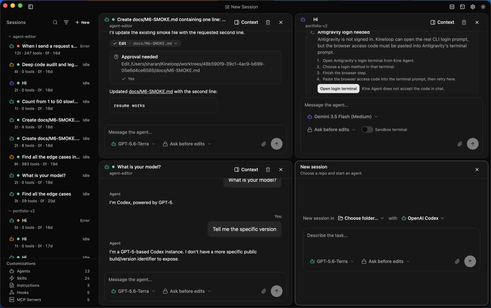

# Kine Agent

> Keep every agent loop under control.

[](LICENSE)
[](https://github.com/sharankarthikyan/kine-agent/releases/latest)
[](https://github.com/sharankarthikyan/kine-agent)


Kine Agent is an **open-source (MIT)**, local-first desktop app that spawns and
supervises AI coding-agent CLIs — Claude Code, OpenAI Codex, and Antigravity — as
subprocesses, and presents them in one structured orchestrator UI: a session list,
live status, diff viewer, and approval gates, with per-session git-worktree isolation.



Instead of juggling several agent CLIs across terminal tabs, you drive them all from
one window. Each session runs in its own git worktree, so the edits agents make
land on a dedicated branch for you to review before anything merges into your repo.

> Formerly "agent-editor" (and briefly "Kineloop"). Existing `~/.agent-editor/` or
> `~/.kineloop/` data is migrated to `~/.kine-agent/` automatically on first launch.

## Highlights

- **Multiple agents, one UI.** Start a session with Claude, Codex, or Antigravity;
  the session list, diff viewer, and approval flow are identical across agents.
- **Per-session review boundary.** Every session gets its own git worktree
  (`~/KineAgent/worktrees/<id>`) on a dedicated branch, so every change is diffable
  and revertible before it reaches your repo. Review the diff, then merge or discard.
- **Live, normalized events.** Three different agent CLIs emit three different JSON
  shapes; an adapter layer normalizes them to one event stream (tokens, tool calls,
  file writes, usage, done/error).
- **Reads your existing CLI history.** Past Claude / Codex / Gemini / Antigravity CLI
  sessions on disk are listed read-only alongside Kine Agent's own — searchable and
  filterable by status and source.
- **Your login, or your key.** By default each CLI runs under your own existing login
  (subscription/OAuth) and models are discovered from the CLI itself. Optionally, for
  Claude and Codex, you can bring your own API key in Settings — stored in your OS keychain
  and injected only at spawn (Antigravity's CLI has no key path, so it stays login-only).
- **Cross-platform.** macOS, Windows, and Linux (paths and CLI shims resolved per OS).

## Agent support

| Agent | New sessions | History (read-only) | Notes |
|-------|:---:|:---:|-------|
| **Claude Code** | ✅ full | ✅ | ACP by default (needs Node); falls back to piping `claude -p --output-format stream-json` |
| **OpenAI Codex** | ✅ full | ✅ | ACP by default (needs Node); falls back to piping `codex exec --json`. Resumes by captured thread id |
| **Antigravity** (`agy`) | ✅ text-only | ✅ | `agy --print` emits final text only — no live tool/file/usage events; scoped to the worktree via `--add-dir` |
| **Gemini CLI** | — | ✅ | deprecated upstream (succeeded by Antigravity); history listed, spawning gated |

The engine is derived automatically — there is no engine picker. Claude and Codex run
over [ACP](https://agentclientprotocol.com/) when Node is available (the pinned adapter
packages are installed once, integrity-verified against lockfiles shipped in the app);
without Node they fall back to the pipe transports above. Only ACP carries live tool,
file, and usage events.

Codex is enabled out of the box. Claude Code and Antigravity are opt-in behind a one-time
notice in **Settings → Agents**, because driving a *consumer subscription* through a
third-party tool sits differently with each vendor — see [Vendor terms](#vendor-terms).

## Installing

Download the build for your OS from the
[latest release](https://github.com/sharankarthikyan/kine-agent/releases/latest).

**macOS:** the app is not yet notarized by Apple, so Gatekeeper will warn on first
launch ("Kine Agent can't be opened because Apple cannot check it for malicious
software"). To open it, **right-click (or Control-click) the app icon → Open → Open**,
or go to **System Settings → Privacy & Security** and click **Open Anyway**. You only
need to do this once. (Windows SmartScreen shows a similar one-time "More info → Run
anyway" prompt.)

**On signing, precisely:** in-app updates *are* signed — every release artifact is
minisign-signed in CI and verified against a public key compiled into the app before
it relaunches. The bundles are **not** OS code-signed or Apple-notarized, which is what
the one-time Gatekeeper/SmartScreen prompt above is about. Those are two different
things; "signed builds" on its own would be misleading.

## Stack

- **Backend core:** Rust, in a Tauri 2 desktop shell (`kine-agent` crate / `kine_agent_lib`)
- **Frontend:** React + Vite + TypeScript + Tailwind v4 + shadcn/ui, running in the
  system WebView
- **Persistence:** SQLite via `sqlx` (`~/.kine-agent/kine-agent.db`); append-only event log
- **Secrets:** by default none stored — agent CLIs handle their own login. The one
  exception is an optional API key you choose to save (Claude/Codex): it's kept in the OS
  keychain via the `keyring` crate — never in the SQLite database, logs, or process argv —
  and Kine Agent never writes to the CLIs' own credential stores
- **Agents:** driven headless as subprocesses; one `AgentAdapter` per agent normalizing
  to a single `AgentEvent` enum

## Architecture

```
React UI  ──Tauri IPC──▶  Rust core
                          ├─ Supervisor      spawn / stream / cancel agent CLIs
                          ├─ AgentAdapter     claude · codex · antigravity (one per agent)
                          ├─ WorktreeManager  one git worktree per session
                          └─ SessionStore     SQLite: sessions + append-only events
```

The frontend cannot call arbitrary FS/shell — IPC is capability-allowlisted. Adding a
new agent means writing one adapter; the UI is untouched.

## Getting started

Prerequisites: [Rust](https://rustup.rs/), Node.js 20+, and the agent CLIs you want to
drive on your `PATH` (`claude`, `codex`, and/or `agy`).

```bash
npm install
npm run tauri dev      # run the desktop app in dev mode
```

### Build

```bash
npm run tauri build    # produce a platform bundle
```

### Tests

```bash
npm test                       # frontend (Vitest)
cargo test --manifest-path src-tauri/Cargo.toml   # backend (Rust)
cargo clippy --manifest-path src-tauri/Cargo.toml --all-targets
```

## Data & privacy

Kine Agent is local-first with **no telemetry, no analytics, and no accounts**. It makes
exactly three kinds of network calls of its own, all to fixed endpoints: checking this
repository's GitHub Releases for app updates, downloading the pinned agent-adapter
packages from the npm registry on first ACP use (integrity-verified against lockfiles
shipped in the app), and — only if you add an API key — fetching that vendor's model list
directly from the vendor's API with your key. Session content is never transmitted.
Each agent CLI uses its own login by default; the only credential
Kine Agent ever stores is an **optional** API key you choose to add for Claude or Codex,
held in your **OS keychain** (never in the database or logs) and used only to authenticate
that agent's own CLI.

- **Where data lives.** Sessions and the append-only event log are stored under
  `~/.kine-agent/`; each session's worktree lives under `~/KineAgent/worktrees/`.
- **Recorded verbatim, unencrypted.** To let you review and resume sessions, Kine Agent
  records session content as-is on your machine: your prompts, the agents' replies, the
  commands they run, and those commands' output go into a local SQLite database and event
  log under `~/.kine-agent` (file permissions restricted to your user on macOS/Linux). If a
  prompt or command output contains a secret, it is stored as-is. Nothing is sent anywhere.
- **Review boundary, not a sandbox.** Kine Agent reviews the file edits an agent makes in its
  worktree; it does **not** sandbox what the agent's own process can access on your machine.
  Some CLIs apply their own sandboxing; full-access modes are opt-in per session.
- **Deleting history.** Deleting a session, or removing the `~/.kine-agent` folder, deletes
  that history.

## Status

MVP, local-only. Cloud/remote control, live-terminal attach, and mobile are
intentionally deferred to later phases.

## Vendor terms

Kine Agent spawns each vendor's **own official CLI** on your machine. It never handles
a vendor credential, never offers a vendor login, and never calls a vendor API on your
behalf — the CLI authenticates itself, exactly as it does when you run it in a terminal.
That distinction is the one the vendors' rules turn on, and it lands differently for each:

- **OpenAI Codex** — supported. `codex exec` is official automation and signing in with
  your ChatGPT plan is a documented path. Enabled by default.
- **Claude Code** — Anthropic's
  [Consumer Terms](https://code.claude.com/docs/en/legal-and-compliance) prohibit
  third-party developers from offering a Claude.ai login or *routing requests through*
  Free/Pro/Max credentials on behalf of users — i.e. lifting an OAuth token and calling
  the API as if you were Claude Code. Kine Agent does neither. Anthropic has separately
  stated that `claude -p`, ACP, and third-party apps built on the Agent SDK continue to
  work with Claude subscriptions, with advance notice before any change. A stated
  position is not a guarantee, so Claude is opt-in behind a one-time notice.
- **Antigravity** — Google's
  [Additional Terms](https://antigravity.google/terms) state that using third-party
  software to access the Service is a breach of the agreement and grounds for
  termination, and Google **has permanently banned paid subscribers** for it, without
  warning. `agy` has no API-key alternative. Antigravity is opt-in behind a notice that
  says exactly this. Enable it only if you accept that risk for your own Google account.

If you'd rather not rely on a subscription login at all, add your own API key for Claude
or Codex in **Settings → Agents** — that is the path those vendors document for
developers. Either way, your use of these CLIs is governed by each vendor's terms and
you are responsible for complying with them.

## Disclaimer

Kine Agent is an independent project and is **not affiliated with, sponsored by, or
endorsed by** Anthropic, OpenAI, or Google. "Claude", "Claude Code", "Codex",
"Gemini", and "Antigravity" are trademarks of their respective owners; they are
referenced here only to describe compatibility.
